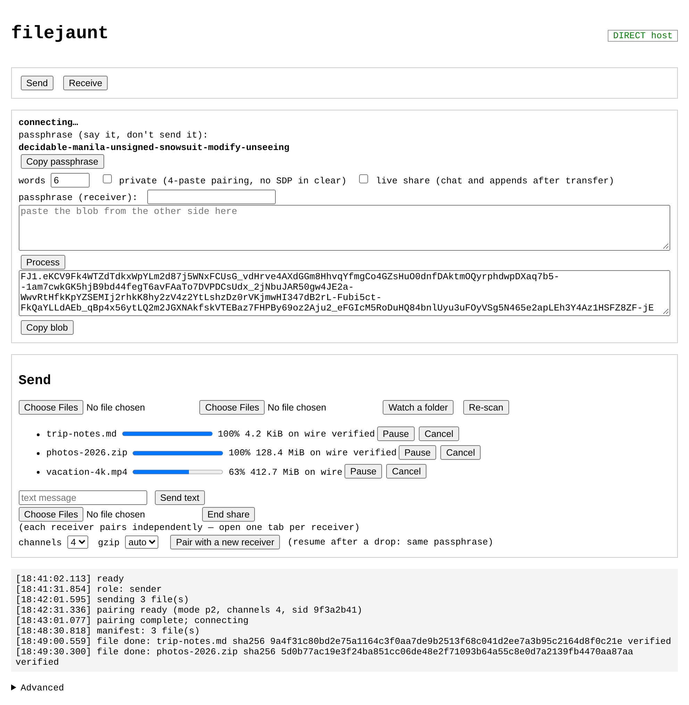
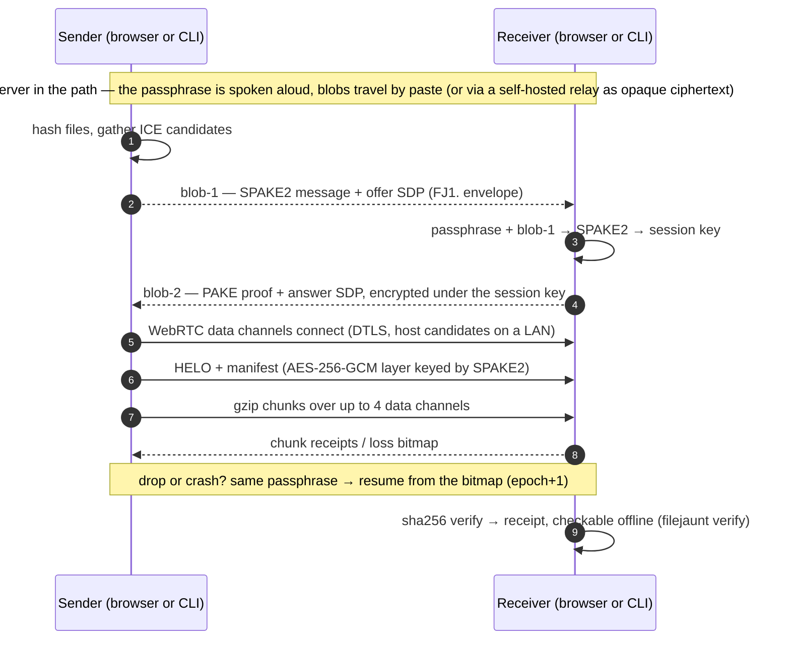

# filejaunt — core

[](https://github.com/jaltez/filejaunt/actions/workflows/ci.yml)

**filejaunt** — encrypted peer-to-peer file transfer: browser↔browser and
browser↔CLI. No signaling server, no data relay, resumable, ephemeral by
construction. Rust core (SPAKE2 + AES-256-GCM), WASM web client, CLI.
Licensed AGPL-3.0-only.

> No install needed: **<https://filejaunt.com>** hosts the reference app —
> free to use, transfers never touch its server.

Encrypted P2P file transfer: browser↔browser and browser↔CLI, no signaling
server, no data relay, resumable, ephemeral by construction. This README
covers the core repository; the product spec lives in
[`docs/SEED.md`](docs/SEED.md) and the security model in
[`docs/SECURITY.md`](docs/SECURITY.md). The WASM engine library is
documented in [`docs/LIBRARY.md`](docs/LIBRARY.md).

## How it works





## Quickstart

```sh
# web library + reference app
cargo install wasm-pack
wasm-pack build crates/fj-wasm --target web --out-dir pkg --out-name filejaunt_wasm
cd web && npm install && node build.mjs
# dist/fj.js          DOM-free library (ESM, wasm inlined); see docs/LIBRARY.md
# dist/filejaunt.html minimal reference app; open it in two tabs or two machines

# CLI
cargo install --path crates/fj-cli
filejaunt send FILE...          # prints passphrase + blob-1, waits for blob-2
filejaunt receive --out DIR     # paste blob-1, type the passphrase, paste blob-2 back
filejaunt doctor --stun public  # NAT diagnosis
filejaunt verify --receipt FILE # receipt check (exit 0 VALID / 3 INVALID)

# CLI with a signaling relay (Wormhole-style, zero pastes)
cargo install --path crates/fj-relay
fj-relay 9000                   # run once anywhere; put TLS in front for WAN
# machine A
filejaunt send FILE --relay wss://your-host/ws   # prints: fj-9f3a2b41-word-one-...
# machine B
filejaunt receive --out DIR --relay wss://your-host/ws
pairing code (or passphrase): fj-9f3a2b41-word-one-...   # paste the one line, done
```

Default pairing = passphrase (voice/second channel) + two paste blobs; no
server involved and LAN sessions use host candidates only (`--stun none`).
With a relay, pairing collapses to a single one-line code: the room id rides
in the code and the blobs travel through the relay encrypted — the relay
sees only the room id and ciphertext. Both sides also print an 8-hex
checksum to compare, which detects a MITM in the signaling path.

### Running the relay in production

```sh
docker build -t fj-relay .          # repo root: distroless image, non-root
docker run -p 8088:8088 fj-relay    # wss://your-host/ws behind your proxy
```

Put TLS on it (any reverse proxy; Dokploy's Traefik just works) and let the
proxy append the client IP to `X-Forwarded-For` — the relay reads the LAST
hop for its abuse caps: 8 concurrent sockets per IP, 20 000 total, 10 000
rooms (2 peers each, idle rooms reaped after 10 min). No state, no config,
no env vars; `GET /healthz` answers `ok` for uptime checks.

## Feature status

| Feature | Status |
|:--|:--|
| E2E encryption (DTLS + SPAKE2-derived AES-GCM layer) | done |
| Resume after disconnect/crash (bitmap, epoch+1) | done (CLI + web) |
| Streaming playback (fragmented mp4 for MSE) | done (web) |
| Path transparency badge (DIRECT/RELAY) | done |
| NAT diagnosis (`doctor`) | done |
| CLI ↔ web interop (one protocol core, Rust + WASM) | done |
| gzip chunk compression (auto/on/off) | done |
| Multi-channel (4) + fan-out (up to 4 receivers, CLI; web UI is one receiver per tab) | done |
| Per-file receipts + offline verify | done |
| One-line pairing via self-hosted relay (`fj-<room8>-<words>` + checksum) | done (CLI + web library) |

## Layout

```
crates/fj-protocol   pure sans-IO core: framing, crypto, PAKE, state machine
crates/fj-webrtc     webrtc-rs glue, STUN client, NAT classifier
crates/fj-cli        `filejaunt` binary
crates/fj-relay      optional signaling relay (rooms, opaque blobs only)
crates/fj-wasm       wasm-bindgen facade for the web client
crates/xtask         dev tasks (`cargo xtask gen-vectors`)
fuzz/                cargo-fuzz targets (frame_decode, envelope_parse; guided fuzzing runs locally, see Testing)
tests/               multi-process CLI e2e + protocol vectors
web/                 DOM-free TS engine (library) + minimal reference app
e2e/                 Playwright browser suite
```

## Testing

```sh
scripts/gen-fixtures.sh
cargo fmt --check && cargo clippy --workspace -- -D warnings
cargo test --workspace
cargo test --workspace --release -- --ignored   # CLI e2e (loopback)

# guided fuzzing (coverage-guided, nightly + musl):
rustup toolchain install nightly --profile minimal
rustup target add x86_64-unknown-linux-musl --toolchain nightly
sudo apt-get install -y musl-tools
cd fuzz && cargo fuzz run frame_decode -s none -- -max_total_time=60

wasm-pack test --node crates/fj-wasm
cd web && node build.mjs && cd ../e2e && npx playwright test
```

Documented deviations from the seed design are listed in
[`docs/SECURITY.md`](docs/SECURITY.md#deviations).

## License

AGPL-3.0-only — free to use, study, modify and redistribute. Any network
service derived from it must publish its modified source code (section 13 of
the license). See [`LICENSE`](LICENSE).

## Roadmap

- [ ] QR pairing (passphrase via QR + blob via link/separate channel)
- [ ] Multi-receiver fan-out in the web UI (slots sharing reads)
- [ ] Opt-in TURN with a persistent status UI (amber relay)
- [ ] 65519 chunk-size negotiation window when the peer announces large SCTP
- [ ] Web worker for OPFS + hashing (no jank on large transfers)
- [ ] i18n (ES/EN) for product strings
- [ ] Publish to crates.io (`filejaunt` bin) and release signatures (minisign)
