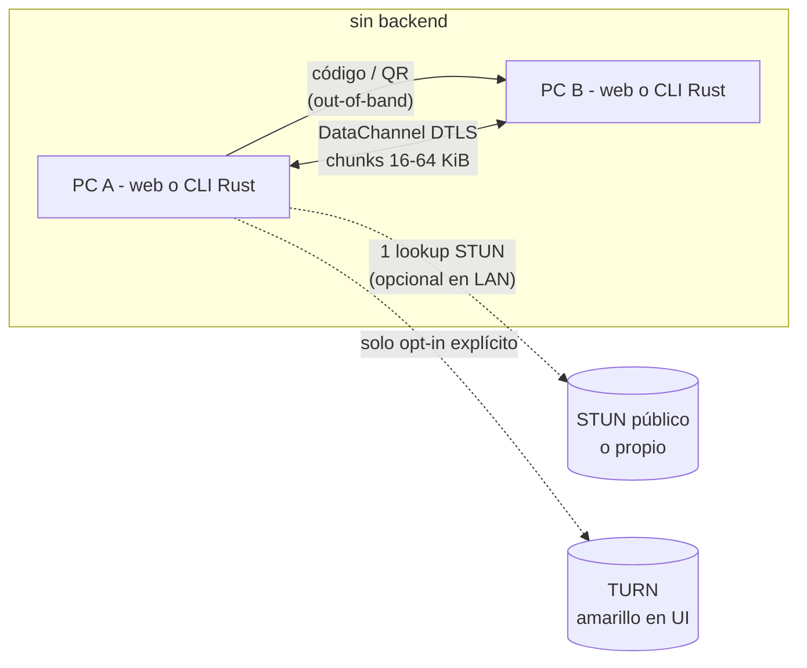

# filejaunt — Semilla de diseño

Transferencia de ficheros P2P navegador↔navegador y navegador↔CLI: cifrada, efímera, sin servidor de signaling y sin relay de datos, con transparencia de ruta verificable como identidad de producto.

- Estado: **semilla** (sin código todavía). Este documento es la fuente de verdad para PRD/beads/impl.
- Fecha: 2026-11-05
- Evidencia: investigación completa en `browser-p2p-report-2026.md` y `agents/voyager/20261105-134652-*/` (prompt, plan, fuentes). Citaciones `[n]` al final.

---

## 1. Visión

Dos personas abren una página (o una persona abre la página y la otra el CLI), comparten un código, y los ficheros viajan **directos** entre sus máquinas. Cerrar la pestaña o el proceso termina la transferencia: nada persiste en ningún servidor porque no hay servidor.

Posicionamiento que la competencia estructuralmente no puede copiar sin dejar de ser lo que es:

| Promesa | Fundamento |
|:---|:---|
| "Tus ficheros nunca pasan por nuestra infraestructura" | No hay signaling server ni storage; el handshake viaja por QR/código [1][2] |
| "Siempre sabes por dónde va" | Badge DIRECTO/RELAY + panel técnico en vivo, siempre visible |
| "Cortó y se reanuda" | Protocolo con bitmap de chunks y sesión re-conectable [14][15] |
| "Cifrado y autenticado por el código" | DTLS obligatorio [3] + PAKE (SPAKE2) que autentica el SDP [9] |
| "Efímero por construcción" | Sin cuentas, sin historial, sin service worker de fondo |

## 2. Objetivos y no objetivos

**Objetivos**
- Página estática única (idealmente un solo HTML autocontenido) + CLI en **Rust** interoperable.
- Cero relay de datos; cero signaling server; STUN configurable (única dependencia de terceros, opcional en LAN [2]).
- Transferencias multi-GB sin reventar RAM: streaming a disco/backpressure.
- Reanudación tras desconexión o cierre.
- Autenticación de par con PAKE; metadatos solo dentro del canal cifrado.

**No objetivos (v1)**
- Transferencias en background con pestaña cerrada (el navegador no lo permite [14]; es parte del producto, no un defecto).
- Anonimato (el par directo ve tu IP; documentado en el modelo de amenazas).
- Movil nativa, apps de escritorio, cuentas de usuario.

## 3. Arquitectura



- **Signaling**: intercambio manual de dos blobs (offer/answer protegidos por PAKE). Sin servidor, por diseño [1][2].
- **STUN**: una consulta por sesión para descubrir dirección pública en internet; en LAN no hace falta (candidatos host) [2].
- **TURN**: opt-in manual con credenciales propias; si se activa, la UI lo muestra en ámbar de forma permanente. Sin TURN, ~15–30% de sesiones fallarán por NAT simétrico/CGNAT/UDP bloqueado [6][7][8] → el producto lo **diagnostica**, no lo oculta.

Emparejamiento (modo código PAKE):

```mermaid
sequenceDiagram
    participant A as PC A
    participant B as PC B
    A->>A: genera passphrase corta (N palabras)
    A->>A: SPAKE2(passphrase) → K_session
    A->>A: crea offer; cifra offer+sid con K_session (AES-GCM)
    A-->>B: blob-1 por QR / pegar (canal cualquiera)
    Note over A,B: passphrase viaja por canal distinto al blob<br/>(voz, chat, o el propio QR si es visual/local)
    B->>B: SPAKE2(passphrase) → K_session; descifra y valida
    B->>B: crea answer; cifra con K_session
    B-->>A: blob-2
    A->>A: descifra, setRemoteDescription
    A<<->>B: DataChannel DTLS directo
```

Modo QR (confianza por línea de visión): el QR contiene blob-1 + passphrase; válido cuando el receptor escanea físicamente la pantalla del emisor. El modo código exige passphrase y blob por canales distintos (defense-in-depth frente a un canal intermedio hostil).

## 4. Modelo de seguridad

Garantías y no garantías, sin marketing:

| Amenaza | Protección |
|:---|:---|
| Observador de red (ISP, wifi) | DTLS obligatorio en DataChannel [3] |
| Canal que transporta el código/blob (chat, proxy) | SPAKE2: un atacante que reescribe el blob no puede derivar K_session sin adivinar la passphrase online [9]; cualquier sustitución de fingerprint falla la desencriptación |
| Servidor web que sirve el JS | Distribución como fichero único con hash verificable; sin CDN, sin canal de actualizaciones |
| Relay TURN (si opt-in) | Segunda capa AES-GCM por chunk con clave PAKE: el relay ve DTLS pero la app no depende de esa negociación |
| El otro extremo | Recibo: SHA-256 por fichero + HMAC con K_session, mostrado en ambos lados |

No garantizado: anonimato (el par directo conoce tu IP y el timing/volumen), integridad del extremo (malware en cualquiera de las máquinas), disponibilidad (si ICE falla, no hay mágica: diagnóstico + TURN opt-in + "prueba hotspot").

Cripto: nada casero. SPAKE2 de implementación establecida (en Rust, evaluar el crate `spake2` usado por `magic-wormhole.rs`, o SPAKE2 sobre `curve25519-dalek`); AES-GCM/SHA-256/HKDF vía WebCrypto en web y crates estándar en Rust. La app web debe pasar por Web Worker para que la clave no viva en el hilo de UI más de lo necesario.

## 5. Protocolo de transferencia (wire v1)

Todos los mensajes tras abrir el canal son **frames binarios** (little-endian):

```
u8  version = 1
u8  type
u16 stream_id
u32 seq          // índice de chunk dentro del stream (CHUNK) o monótono (control)
u32 length
payload[length]  // cifrado AES-GCM con K_session, AAD = cabecera
```

Tipos: `HELLO 0x01 · MANIFEST 0x02 · CHUNK_REQ 0x03 · CHUNK 0x04 · BITMAP 0x05 · PAUSE 0x06 · CANCEL 0x07 · RECEIPT 0x08 · TEXT 0x09 · ERROR 0x0A`

### 5.1 Manifiesto

Primera transmisión tras HELLO, JSON dentro del canal cifrado: sesión (`sid`, derivado de K_session), ficheros `{id, name, path, size, sha256, chunk_size, chunks, encoding}`, `created`. **Ningún metadato (nombre, tamaño, tipo) sale del canal cifrado**: quien mire el QR solo ve opacidad.

### 5.2 Chunks y backpressure

- `chunk_size` = 16 KiB interop seguro; negociable hasta 64 KiB vía `maxMessageSize` [5].
- Envío gobernado por `bufferedAmount`: pausa al umbral alto (`bufferedAmountLowThreshold`), reanuda al bajo [5]. Nunca se carga el fichero entero: lectura por rangos (`file.slice`) en web, `read` secuencial en Rust.
- Orden **sequential-first** por defecto (streaming); `CHUNK_REQ` permite pedir rangos concretos (reenvío de huecos, resume).

### 5.3 Reanudación (F-01)

- Receptor persiste por `sid`: manifiesto + bitmap de chunks recibidos + handle de fichero (IndexedDB/OPFS en web [15]; sidecar `.filejaunt/<sid>.state` en CLI).
- Al reconectar (mismo código → mismo `sid` → mismo K_session): receptor envía `BITMAP` (RLE); emisor reenvía solo huecos. Verificación SHA-256 al completar antes de prometer "listo".
- Web: escritura por chunk en OPFS desde un Worker (esquiva límites de memoria [15]); pickers de disco FSA solo Chromium [11] → doble ruta (ver §7).

### 5.4 Reproducción streaming (F-02)

Para media: `sequential-first` + en MP4 poner el `moov` delante (remux opcional en el emisor); el receptor alimenta `MediaSource`/`video.src` con los chunks según llegan. El usuario ve el vídeo mientras baja.

### 5.5 Compresión (F-06)

- `encoding: gzip` por stream usando `CompressionStream`/`DecompressionStream` nativos (web, streaming, sin dependencias) y `flate2` (Rust). zstd-wasm como opción posterior.
- Toggle en UI; win evidente en texto/CSV/JSON, off por defecto en datos ya comprimidos (auto: samplear los primeros chunks).

### 5.6 Recibos (F-08)

Al terminar: `RECEIPT {sid, file_id, sha256, bytes, ts}` + HMAC-SHA256(K_session). Ambos extremos muestran el hash; comparación visual opcional ("¿ves 3f9a…?"). Recibo exportable para verificación offline.

### 5.7 Fan-out 1→N (F-07)

Un emisor, N receptores mesh: misma sesión/mismo manifiesto, un DataChannel por receptor, lectura única de disco, envío round-robin. Bitmaps independientes por receptor. v1 lo deja especificado; impl en M3/M4.

## 6. Receptor web (rutas)

| Navegador | Ruta | Límite |
|:---|:---|:---|
| Chromium | FSA `showSaveFilePicker`/`showDirectoryPicker` + `createWritable` → disco directo, árbol de carpetas | Permisos persistentes recientes; re-pedir al resumir |
| Resto | OPFS (Worker) + descarga final por `Blob`/StreamSaver | OPFS existe en FF/Safari [11]; los pickers de disco no [11] |

Selección automática con degradación anunciada en UI ("recibiendo a almacenamiento temporal de X GB libre").

## 7. CLI en Rust

Mismo protocolo, mismo wire, mismos blobs de emparejamiento → **interoperable con el peer web** (golden tests TS↔Rust en CI).

- Transporte WebRTC: **`webrtc-rs`** (puerto Rust de Pion: ICE+DTLS+SCTP+DataChannel con baterías incluidas). Alternativa si la API pesa: `str0m` (sans-IO, más glue). No bindings C++ salvo necesidad.
- Cripto: `spake2` (o `curve25519-dalek`+SPAKE2), `aes-gcm`, `sha2`, `hmac`, `hkdf`, `flate2`.
- QR: render con `qrcode` (para que el peer web/escáner lo lea); el CLI no escanea.
- Backpressure: SCTP `buffered_amount` equivalente en webrtc-rs (`on_buffered_amount_change`).

```
filejaunt send <PATH>... [--words N] [--turn user:pass@turn:host] [--qr] [--gzip auto|on|off]
filejaunt receive <blob-1|passphrase> [-o DIR] [--resume]
filejaunt resume <sid>            # re-conectar sesión interrumpida
filejaunt doctor                  # diagnóstico NAT/ICE/UDP con explicación en texto
```

`doctor` es F-04 en CLI: prueba STUN, clasifica el NAT (full-cone/restricted/symmetric), dice qué va a pasar antes de intentarlo.

## 8. UX y transparencia (F-03/F-04/F-05)

- **Badge permanente de ruta**: `DIRECTO (host|srflx)` verde / `RELAY` ámbar. Nunca oculto.
- **Panel técnico plegable**: candidato seleccionado, RTT, MB/s, `bufferedAmount`, chunks reenviados, compresión on/off (`getStats`).
- **Fallos con diagnóstico accionable**: "NAT simétrico / UDP bloqueado → prueba hotspot móvil o activa TURN" (en vez de spinner infinito).
- **Cola de envío** con prioridad (arrastrar para reordenar), pausa/cancelación por fichero, carpetas con árbol preservado (F-05 del checklist de diferenciadores).
- Efímero: sin storage local de sesiones terminadas; el estado de resume se ofrece a borrar al completar.

## 9. Requisitos (los 8 diferenciadores)

| ID | Requisito | Milestone |
|:---|:---|:---|
| F-01 | Resume tras desconexión (bitmap + re-pair con mismo sid) | M2 |
| F-02 | Reproducción streaming durante recepción | M3 |
| F-03 | Badge DIRECTO/RELAY + panel técnico en vivo | M1 |
| F-04 | Diagnóstico NAT accionable (web + `filejaunt doctor`) | M1 |
| F-05 | CLI Rust interoperable con web | M4 |
| F-06 | Compresión gzip por stream (auto/on/off) | M3 |
| F-07 | Canales paralelos para throughput + fan-out 1→N | M4 |
| F-08 | Recibos: hash en ambos extremos + HMAC exportable | M3 |

## 10. Roadmap

- **M0 — spike vertical**: HTML único, SDP copy/paste sin PAKE, chunks+backpressure, FSA stream, SHA-256. Objetivo: probar el camino completo con 1 GB LAN.
- **M1 — identidad**: PAKE + código corto + QR, badge de ruta, diagnóstico ICE, OPFS fallback.
- **M2 — fiabilidad**: resume completo (IndexedDB/sidecar), cola multi-fichero, carpetas, reordenación.
- **M3 — experiencia**: streaming playback, compresión, recibos.
- **M4 — ecosistema**: CLI Rust (send/receive/doctor) + golden tests interop, TURN opt-in con credenciales, multicanal paralelo, fan-out.

## 11. Riesgos y mitigaciones

| Riesgo | Evidencia | Mitigación |
|:---|:---|:---|
| ICE falla sin TURN (NAT simétrico, CGNAT, UDP bloqueado) | 15–30% de sesiones [6][7][8] | Diagnóstico honesto, TURN opt-in propio, consejo hotspot |
| Throughput single-channel (~50–100 Mbps) | [14] | Multicanal paralelo en M4; 16→64 KiB chunks si `maxMessageSize` lo permite |
| Pickers de disco solo Chromium | [11] | Doble ruta FSA/OPFS degradación anunciada |
| QR no cabe (SDP grande) | [1] comprime; QR ~3 KB ECC-L | Podar SDP + gzip; fallback dos códigos texto |
| PAKE mal implementado | [9] advierte: sin auditoría en proyectos previos | Crate establecido, tests vectors, ningún cripto casero |
| Throttling de timers en pestaña background | límite conocido de navegador [14] | Envío dirigido por Worker + eventos DataChannel, sin `setInterval` |

## 12. Referencias

- Local: `browser-p2p-report-2026.md` (informe), `agents/voyager/20261105-134652-*/` (fuentes crudas).
- [1] stephanlangeveld.com/blog/p2p-file-transfer — app real sin servidor, código gzip+QR, AES-GCM, STUN.
- [2] dev.to/hexshift — peer mínimo con SDP manual (demo, incompleto: sin `createAnswer`).
- [3] MDN — Using WebRTC data channels (DTLS obligatorio).
- [4] webrtc.github.io/samples — datachannel/filetransfer (chunks, reliable/ordered, límites del demo).
- [5] webrtc.link — límites de mensaje 16/64 KB, `bufferedAmount`, backpressure.
- [6] forasoft.com — NAT/STUN/TURN; ~15–25% de sesiones de consumo requieren TURN.
- [7] dev.to/alakkadshaw — NAT traversal; UMA Chrome ~20–25% sesiones relay.
- [8] bloggeek.me — TURN: "0–50% según audiencia; mide, no asumas".
- [9] github.com/saljam/webwormhole (+ HN 23023675) — PAKE autenticando fingerprints WebRTC; experimental, sin auditoría.
- [10] developer.chrome.com/docs/iwa/direct-sockets — Direct Sockets solo IWAs.
- [11] MDN File System API + SO 74618688 — pickers solo Chromium; OPFS en FF/Safari.
- [12] arxiv 2604.12484 — medición hole-punching ~70% (DCUtR/IPFS, contexto DHT).
- [13] github.com/schlagmichdoch/PairDrop — features actuales (texto, carpetas, preview, wake-lock…).
- [14] handrive.ai — por qué WebRTC cuesta para ficheros: sin resume nativo, 50–100 Mbps, sin background.
- [15] transp2p.com — receta resume: OPFS + IndexedDB bitmap + continuar desde chunk N.
