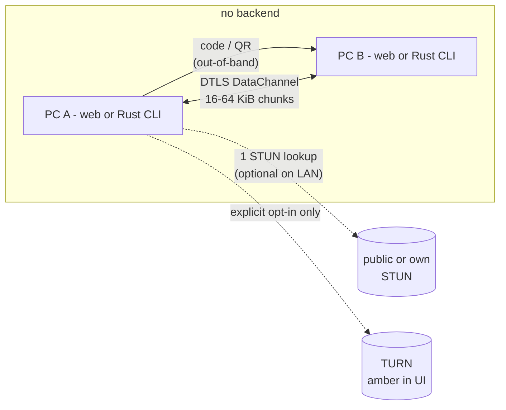

# filejaunt — Design seed

> Note: this document is preserved as the original design source. The
> implementation is complete; documented deviations live in
> `docs/SECURITY.md` § "Documented deviations".

P2P file transfer browser↔browser and browser↔CLI: encrypted, ephemeral,
no signaling server and no data relay, with verifiable path transparency as
the product identity.

- Status: **implemented (v1)** — see README. This document remains the
  original design source of truth; implementation deviations live in
  `docs/SECURITY.md` § Deviations.
- Date: 2026-11-05
- Evidence: full research in `browser-p2p-report-2026.md` and
  `agents/voyager/20261105-134652-*/` (prompt, plan, sources).
  Citations `[n]` at the end.

---

## 1. Vision

Two people open a page (or one opens the page and the other the CLI), share
a code, and the files travel **directly** between their machines. Closing
the tab or process ends the transfer: nothing persists on any server
because there is no server.

Positioning competitors structurally cannot copy without ceasing to be
what they are:

| Promise | Basis |
|:---|:---|
| "Your files never touch our infrastructure" | No signaling server, no storage; the handshake travels via QR/code [1][2] |
| "You always know where it goes" | DIRECT/RELAY badge + live technical panel, always visible |
| "Cut and resume" | Protocol with chunk bitmap and re-connectable session [14][15] |
| "Encrypted and authenticated by the code" | Mandatory DTLS [3] + PAKE (SPAKE2) authenticating the SDP [9] |
| "Ephemeral by construction" | No accounts, no history, no background service worker |

## 2. Goals and non-goals

**Goals**
- Single static page (ideally one self-contained HTML) + interoperable **Rust** CLI.
- Zero data relay; zero signaling server; configurable STUN (the only third-party dependency, optional on LAN [2]).
- Multi-GB transfers without blowing RAM: streaming to disk/backpressure.
- Resume after disconnect or close.
- Peer authentication with PAKE; metadata only inside the encrypted channel.

**Non-goals (v1)**
- Background transfers with a closed tab (browsers do not allow it [14];
  part of the product, not a defect).
- Anonymity (the direct peer sees your IP; documented in the threat model).
- Native mobile, desktop apps, user accounts.

## 3. Architecture



- **Signaling**: manual exchange of two blobs (offer/answer protected by
  PAKE). No server, by design [1][2].
- **STUN**: one lookup per session to discover the public internet
  address; unnecessary on LAN (host candidates) [2].
- **TURN**: manual opt-in with your own credentials; if enabled the UI
  shows it in amber permanently. Without TURN, ~15–30% of sessions fail
  due to symmetric NAT/CGNAT/blocked UDP [6][7][8] → the product
  **diagnoses** it, it does not hide it.

Pairing (PAKE code mode):

```mermaid
sequenceDiagram
    participant A as PC A
    participant B as PC B
    A->>A: generates short passphrase (N words)
    A->>A: SPAKE2(passphrase) → K_session
    A->>A: creates offer; encrypts offer+sid with K_session (AES-GCM)
    A-->>B: blob-1 via QR / paste (any channel)
    Note over A,B: passphrase travels on a different channel than the blob<br/>(voice, chat, or the QR itself if visual/local)
    B->>B: SPAKE2(passphrase) → K_session; decrypts and validates
    B->>B: creates answer; encrypts with K_session
    B-->>A: blob-2
    A->>A: decrypts, setRemoteDescription
    A<<->>B: direct DTLS DataChannel
```

QR mode (line-of-sight trust): the QR contains blob-1 + passphrase; valid
when the receiver physically scans the sender's screen. Code mode requires
passphrase and blob on different channels (defense-in-depth against a
hostile intermediate channel).

## 4. Security model

Guarantees and non-guarantees, no marketing:

| Threat | Protection |
|:---|:---|
| Network observer (ISP, Wi-Fi) | Mandatory DTLS on DataChannel [3] |
| Channel carrying the code/blob (chat, proxy) | SPAKE2: an attacker rewriting the blob cannot derive K_session without guessing the passphrase online [9]; any fingerprint substitution fails decryption |
| Web server serving the JS | Distribution as a single file with verifiable hash; no CDN, no update channel |
| TURN relay (if opted in) | Second AES-GCM layer per chunk with a PAKE key: the relay sees DTLS but the app does not depend on that negotiation |
| The other endpoint | Receipt: SHA-256 per file + HMAC with K_session, shown on both sides |

Not guaranteed: anonymity (the direct peer knows your IP and
timing/volume), endpoint integrity (malware on either machine),
availability (if ICE fails there is no magic: diagnosis + TURN opt-in +
"try a hotspot").

Crypto: nothing home-made. SPAKE2 from an established implementation (in
Rust, evaluate the `spake2` crate used by `magic-wormhole.rs`, or SPAKE2
over `curve25519-dalek`); AES-GCM/SHA-256/HKDF via WebCrypto on web and
standard crates in Rust. The web app should run in a Web Worker so the key
does not live on the UI thread longer than necessary.

## 5. Transfer protocol (wire v1)

All messages after opening the channel are **binary frames**
(little-endian):

```
u8  version = 1
u8  type
u16 stream_id
u32 seq          // chunk index within the stream (CHUNK) or monotonic (control)
u32 length
payload[length]  // AES-GCM encrypted with K_session, AAD = header
```

Types: `HELLO 0x01 · MANIFEST 0x02 · CHUNK_REQ 0x03 · CHUNK 0x04 · BITMAP 0x05 · PAUSE 0x06 · CANCEL 0x07 · RECEIPT 0x08 · TEXT 0x09 · ERROR 0x0A`

### 5.1 Manifest

First transmission after HELLO, JSON inside the encrypted channel: session
(`sid`, derived from K_session), files `{id, name, path, size, sha256,
chunk_size, chunks, encoding}`, `created`. **No metadata (name, size, type)
leaves the encrypted channel**: whoever inspects the QR sees only opacity.

### 5.2 Chunks and backpressure

- `chunk_size` = 16 KiB safe interop; negotiable up to 64 KiB via
  `maxMessageSize` [5].
- Sending governed by `bufferedAmount`: pause at the high threshold
  (`bufferedAmountLowThreshold`), resume at the low one [5]. Never load the
  whole file: ranged reads (`file.slice`) on web, sequential `read` in Rust.
- **Sequential-first** order by default (streaming); `CHUNK_REQ` allows
  requesting specific ranges (gap re-send, resume).

### 5.3 Resume (F-01)

- Receiver persists per `sid`: manifest + bitmap of received chunks + file
  handle (IndexedDB/OPFS on web [15]; `.filejaunt/<sid>.state` sidecar on
  CLI).
- On reconnect (same code → same `sid` → same K_session): receiver sends
  `BITMAP` (RLE); sender re-sends only gaps. SHA-256 verification on
  completion before promising "done".
- Web: per-chunk writes to OPFS from a Worker (dodges memory limits [15]);
  FSA disk pickers are Chromium-only [11] → dual path (see §7).

### 5.4 Streaming playback (F-02)

For media: `sequential-first` + put the MP4 `moov` first (optional remux
on the sender); the receiver feeds `MediaSource`/`video.src` with chunks as
they arrive. The user watches the video while it downloads.

### 5.5 Compression (F-06)

- `encoding: gzip` per stream using native
  `CompressionStream`/`DecompressionStream` (web, streaming, no
  dependencies) and `flate2` (Rust). zstd-wasm as a later option.
- UI toggle; clear win on text/CSV/JSON, off by default on already
  compressed data (auto: sample the first chunks).

### 5.6 Receipts (F-08)

On completion: `RECEIPT {sid, file_id, sha256, bytes, ts}` +
HMAC-SHA256(K_session). Both endpoints show the hash; optional visual
comparison ("do you see 3f9a…?"). Exportable receipt for offline
verification.

### 5.7 Fan-out 1→N (F-07)

One sender, N mesh receivers: same session/same manifest, one DataChannel
per receiver, single disk read, round-robin sending. Independent bitmaps
per receiver. v1 leaves it specified; impl in M3/M4.

## 6. Web receiver (paths)

| Browser | Path | Limit |
|:---|:---|:---|
| Chromium | FSA `showSaveFilePicker`/`showDirectoryPicker` + `createWritable` → direct disk, folder tree | Recent persistent permissions; re-request on resume |
| Rest | OPFS (Worker) + final download via `Blob`/StreamSaver | OPFS exists in FF/Safari [11]; disk pickers do not [11] |

Automatic selection with degradation announced in the UI ("receiving to
temporary storage, X GB free").

## 7. Rust CLI

Same protocol, same wire, same pairing blobs → **interoperable with the
web peer** (TS↔Rust golden tests in CI).

- WebRTC transport: **`webrtc-rs`** (Rust port of Pion: ICE+DTLS+SCTP+
  DataChannel with batteries included). Alternative if the API is heavy:
  `str0m` (sans-IO, more glue). No C++ bindings unless necessary.
- Crypto: `spake2` (or `curve25519-dalek`+SPAKE2), `aes-gcm`, `sha2`,
  `hmac`, `hkdf`, `flate2`.
- QR: render with `qrcode` (so the web peer/scanner can read it); the CLI
  does not scan.
- Backpressure: SCTP `buffered_amount` equivalent in webrtc-rs
  (`on_buffered_amount_change`).

```
filejaunt send <PATH>... [--words N] [--turn user:pass@turn:host] [--qr] [--gzip auto|on|off]
filejaunt receive <blob-1|passphrase> [-o DIR] [--resume]
filejaunt resume <sid>            # reconnect interrupted session
filejaunt doctor                  # NAT/ICE/UDP diagnosis with text explanation
```

`doctor` is F-04 on CLI: tests STUN, classifies the NAT
(full-cone/restricted/symmetric), tells you what will happen before
trying.

## 8. UX and transparency (F-03/F-04/F-05)

- **Permanent path badge**: `DIRECT (host|srflx)` green / `RELAY` amber.
  Never hidden.
- **Collapsible technical panel**: selected candidate, RTT, MB/s,
  `bufferedAmount`, re-sent chunks, compression on/off (`getStats`).
- **Failures with actionable diagnosis**: "symmetric NAT / blocked UDP →
  try mobile hotspot or enable TURN" (instead of an infinite spinner).
- **Send queue** with priority (drag to reorder), per-file pause/cancel,
  folders with preserved tree (F-05 from the differentiator checklist).
- Ephemeral: no local storage of finished sessions; resume state offered
  for deletion on completion.

## 9. Requirements (the 8 differentiators)

| ID | Requirement | Milestone |
|:---|:---|:---|
| F-01 | Resume after disconnect (bitmap + re-pair with same sid) | M2 |
| F-02 | Streaming playback during reception | M3 |
| F-03 | DIRECT/RELAY badge + live technical panel | M1 |
| F-04 | Actionable NAT diagnosis (web + `filejaunt doctor`) | M1 |
| F-05 | Rust CLI interoperable with web | M4 |
| F-06 | Per-stream gzip compression (auto/on/off) | M3 |
| F-07 | Parallel channels for throughput + fan-out 1→N | M4 |
| F-08 | Receipts: hash on both ends + exportable HMAC | M3 |

## 10. Roadmap

- **M0 — vertical spike**: single HTML, SDP copy/paste without PAKE,
  chunks+backpressure, FSA stream, SHA-256. Goal: prove the full path with
  1 GB on LAN.
- **M1 — identity**: PAKE + short code + QR, path badge, ICE diagnosis,
  OPFS fallback.
- **M2 — reliability**: full resume (IndexedDB/sidecar), multi-file queue,
  folders, reordering.
- **M3 — experience**: streaming playback, compression, receipts.
- **M4 — ecosystem**: Rust CLI (send/receive/doctor) + golden interop
  tests, TURN opt-in with credentials, parallel multichannel, fan-out.

## 11. Risks and mitigations

| Risk | Evidence | Mitigation |
|:---|:---|:---|
| ICE fails without TURN (symmetric NAT, CGNAT, blocked UDP) | 15–30% of sessions [6][7][8] | Honest diagnosis, own opt-in TURN, hotspot advice |
| Single-channel throughput (~50–100 Mbps) | [14] | Parallel multichannel in M4; 16→64 KiB chunks if `maxMessageSize` allows |
| Disk pickers only Chromium | [11] | Dual FSA/OPFS path with announced degradation |
| QR does not fit (large SDP) | [1] compresses; QR ~3 KB ECC-L | Prune SDP + gzip; two-text-code fallback |
| Poorly implemented PAKE | [9] warns: unaudited in prior projects | Established crate, vector tests, no home-made crypto |
| Timer throttling in background tab | known browser limit [14] | Sending driven by Worker + DataChannel events, no `setInterval` |

## 12. References

- Local: `browser-p2p-report-2026.md` (report), `agents/voyager/20261105-134652-*/` (raw sources).
- [1] stephanlangeveld.com/blog/p2p-file-transfer — real serverless app, gzip+QR code, AES-GCM, STUN.
- [2] dev.to/hexshift — minimal peer with manual SDP (demo, incomplete: no `createAnswer`).
- [3] MDN — Using WebRTC data channels (DTLS mandatory).
- [4] webrtc.github.io/samples — datachannel/filetransfer (chunks, reliable/ordered, demo limits).
- [5] webrtc.link — 16/64 KB message limits, `bufferedAmount`, backpressure.
- [6] forasoft.com — NAT/STUN/TURN; ~15–25% of consumer sessions need TURN.
- [7] dev.to/alakkadshaw — NAT traversal; Chrome UMA ~20–25% relay sessions.
- [8] bloggeck.me — TURN: "0–50% depending on audience; measure, don't assume".
- [9] github.com/saljam/webwormhole (+ HN 23023675) — PAKE authenticating WebRTC fingerprints; experimental, unaudited.
- [10] developer.chrome.com/docs/iwa/direct-sockets — Direct Sockets IWAs only.
- [11] MDN File System API + SO 74618688 — pickers only Chromium; OPFS in FF/Safari.
- [12] arxiv 2604.12484 — hole-punching measurement ~70% (DCUtR/IPFS, DHT context).
- [13] github.com/schlagmichdoch/PairDrop — current features (text, folders, preview, wake-lock…).
- [14] handrive.ai — why WebRTC is hard for files: no native resume, 50–100 Mbps, no background.
- [15] transp2p.com — resume recipe: OPFS + IndexedDB bitmap + continue from chunk N.
